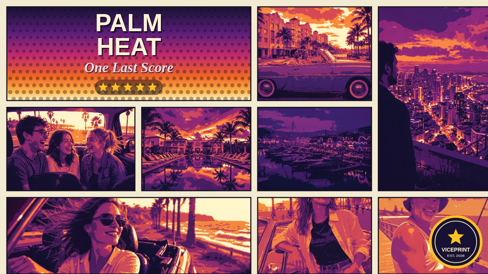

# VICEPRINT — Palm Heat Cover Studio

Turn your photos and a caption into GTA-style multi-panel poster covers, and export them as PNGs in square, portrait, wide and story sizes.

## What it does

VICEPRINT is a fully offline cover studio that runs as static files in a desktop browser — no server, no network, no libraries. It ships with eight photos (six made for the studio, two samples) and accepts your own uploads, which never leave the page.

- **Layouts** — *Poster Nine*: an asymmetric nine-cell grid whose first cell is a dedicated halftone title block, the other eight holding photos. *Tilted Stack*: four snapshots at angles over a dark dotted backdrop. *Hero + Strip*: one wide hero panel over a three-frame filmstrip.
- **Banded ink grades** — every photo is posterized and gradient-mapped, so it prints as poster art rather than a filtered snapshot: Poster Ink, Sunset Duotone, Neon Nights, Golden Hour, Noir, and Clean Colour.
- **Editing** — click a panel, then a photo to place it; drag on the cover to pan a panel's photo and use the zoom slider to crop tighter; spread one photo across every panel or shuffle the arrangement; undo and redo cover every change.
- **Caption** — an editable title set as stacked display lettering in the title block, a script subtitle, and a one-to-five-star heat meter, plus the round VICEPRINT badge.
- **Export** — one click renders a PNG at 1080×1080, 1080×1350, 1920×1080 or story size 1080×1920, or exports all four sizes at once.

## How it is put together

`app/` holds the whole studio: `index.html`, `style.css`, and `src/` — `cover.js` (the canvas renderer: layouts, grades, lettering, halftone, badge), `main.js` (the editor: state, history, picking, drag-pan, uploads, export) and `shots.js`/`shots.json` (deterministic screenshot scenes). The photos live in `app/assets/` and `app/samples/`.

## How judging works

The entry point is `main.ts` (Node 22, standard library only). It copies `app/` and `screenshots/` into the output directory — clearing only the directory's contents, never the mounted directory itself — and writes `dossier.json` with `buildDossier` from the bounty's own `vendor/makefun-app.ts`, so the dossier is byte-for-byte what the scorer builds from the same tree: an inventory of the app plus its sources in load order, and the screenshots with the first by name as the cover.
